<p align="center"></p>

# JalNetra: Because 2 Hours 43 Minutes Is Too Late

> On 26 August 2026 a glacier collapsed above Langtang in Nepal. The flood raced **226 km** to the Indian border.
> The first alarm on the gauge network came **2 h 43 min** after the collapse. By then the gauges near the source had gone dark, still reading normal.
>
> **JalNetra closes that gap**: it watches every river, finds the villages the water will reach, draws the area that must be emptied, and lets a person approve a Hindi warning that the village head confirms and that is then escalated to the people in that area. Hours earlier.

**Live demo:** https://d1oi8xa605dsj6.cloudfront.net

<p align="center">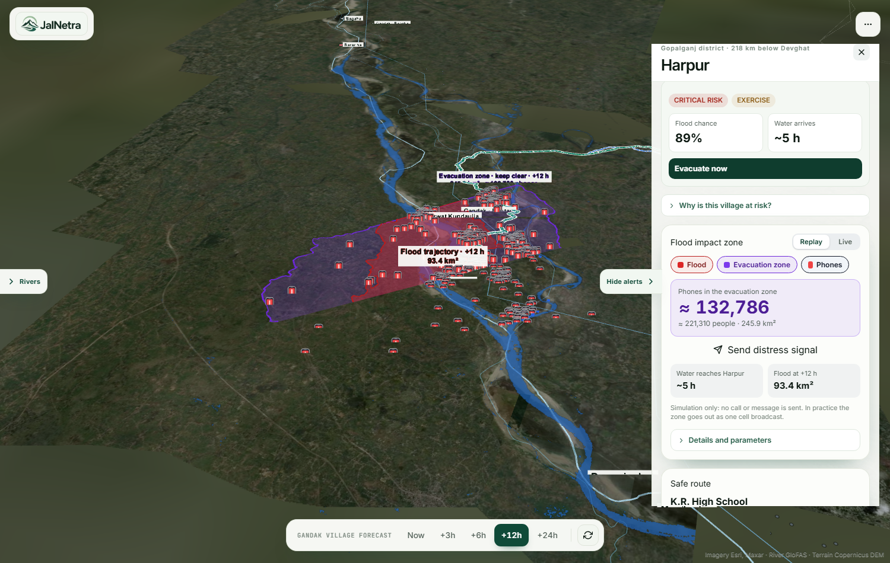</p>
<p align="center"><sub>Harpur at +6 h: red is where the flood goes, violet is the evacuation zone, phone icons are the estimated phones inside it.</sub></p>

---

## Contents
1. [What it does](#what-it-does)
2. [How it works](#how-it-works)
3. [Screenshots](#screenshots)
4. [Satellite data: Sentinel-1 and Sentinel-2](#satellite-data-sentinel-1-and-sentinel-2)
5. [The model](#the-model)
6. [Flood polygons, people and phones](#flood-polygons-people-and-phones)
7. [Backend](#backend)
8. [Two-stage escalation: Sarpanch, then citizens](#two-stage-escalation-sarpanch-then-citizens)
9. [Parameters used](#parameters-used)
10. [Run it yourself](#run-it-yourself)
11. [Repo map](#repo-map)
12. [Honest numbers, safety and limits](#honest-numbers-safety-and-limits)
13. [Part 2: Oasis Builder](#part-2-oasis-builder-the-prevention-app)
14. [Data and team](#data)

---

## What it does

| | |
|---|---|
| **Watch** | 681 river points across India, checked against each river's own record |
| **See** | Sentinel-1 radar and Sentinel-2 optical scenes, live on the map and used to calibrate the flood model |
| **Predict** | Which of 291 villages along the Gandak the water reaches, and when (now, +3, +6, +12, +24 h) |
| **Map** | A **flood trajectory polygon** (where the water goes) and an **evacuation zone polygon** (what to keep empty), shaped by the flood, not by a circle |
| **Count** | Estimated people and mobile phones inside the evacuation zone |
| **Decide** | A person reviews the map and the advisory, then approves or rejects. Nothing is automatic |
| **Confirm** | The Sarpanch gets a two-way voice call and a Telegram message and says *escalate* or *false alarm* |
| **Warn** | Only after the Sarpanch confirms: a short, urgent Hindi + English call to the citizens in the zone, a 3D evacuation route and an AR arrow to the safe place |

## How it works

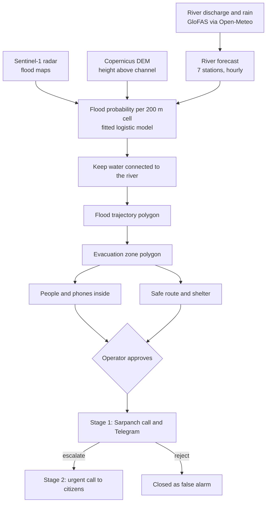

The flow of the site: **Home → Glacier story → Live map → Approve → the phone rings → the Sarpanch decides → the citizens are called.**

## Screenshots

| | |
|---|---|
| 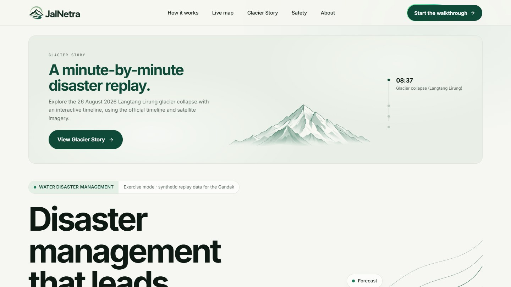<br/>**Home** | 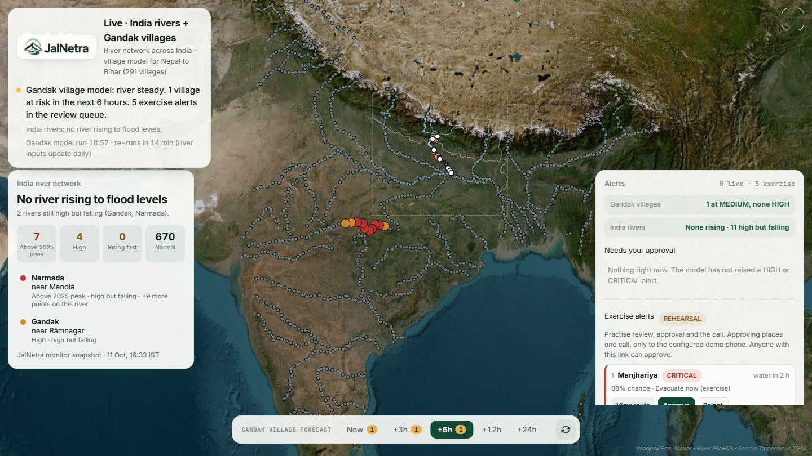<br/>**Live India map**: every river point, rising ones flagged |
| 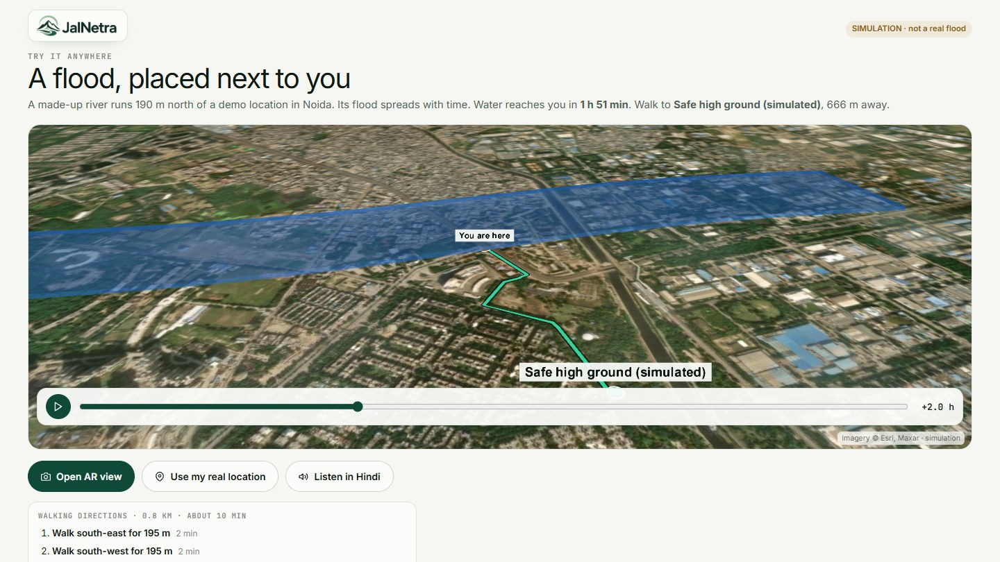<br/>**Flood and evacuation route** | 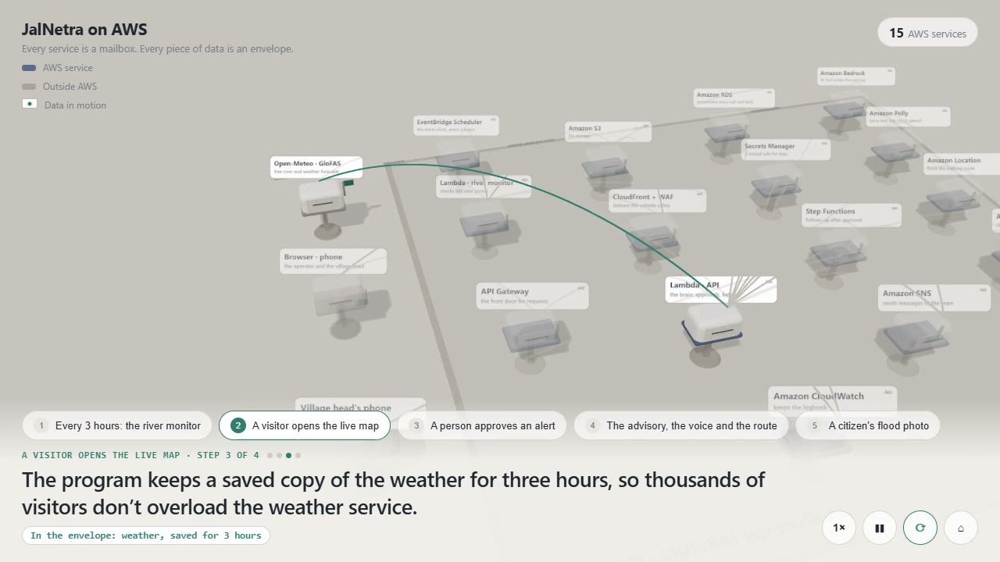<br/>**AWS data flow (3D)** |
| <br/>**Flood trajectory (red), evacuation zone (violet), phones** | 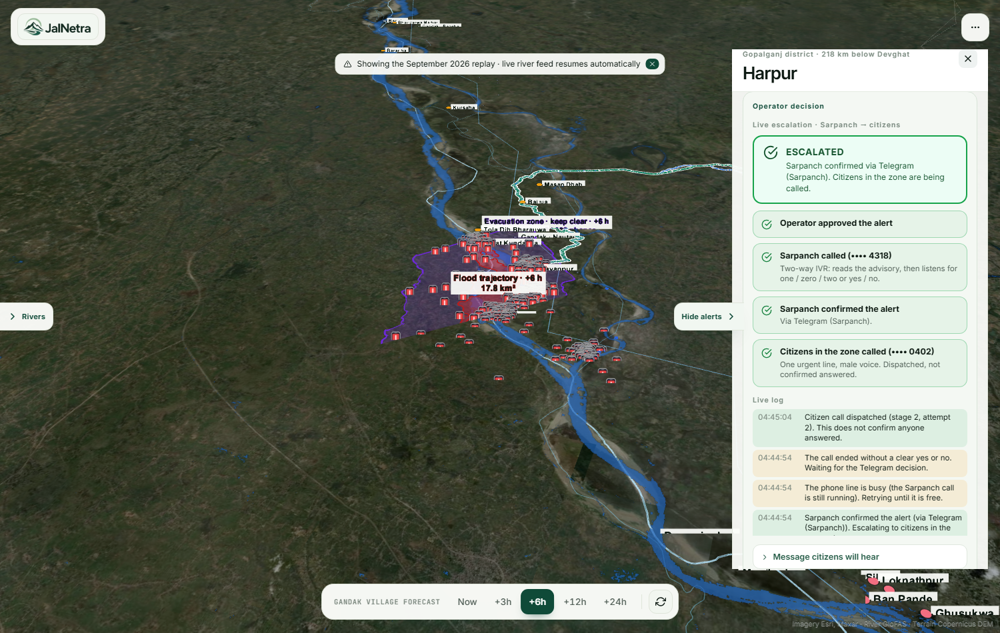<br/>**Live escalation: ESCALATED**, with the live log |

<p align="center">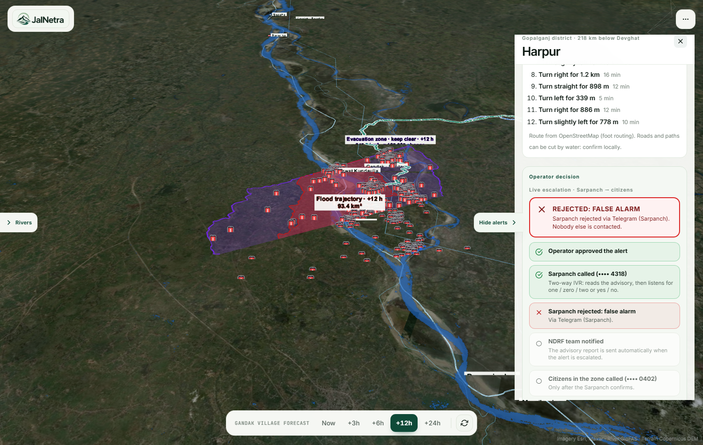</p>
<p align="center"><sub>The same panel when the Sarpanch rejects: "REJECTED: FALSE ALARM". Nobody else is contacted.</sub></p>

## Satellite data: Sentinel-1 and Sentinel-2

Both satellites come from the free **Microsoft Planetary Computer** STAC catalogue (`https://planetarycomputer.microsoft.com/api/stac/v1`), with signed asset URLs and no API key. They are used in two places: offline, to build and calibrate the model; and live, to show the newest scenes on the map.

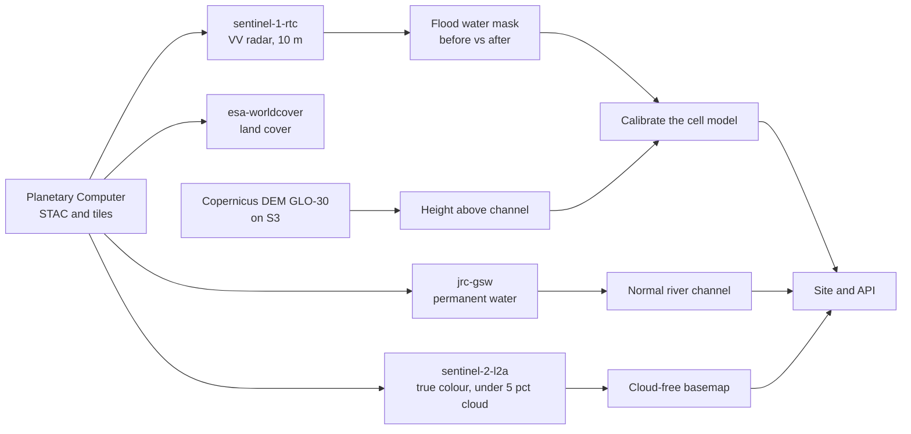

### Sentinel-1 (radar): where was the water?
Radar sees through cloud and at night, which is what a flood needs. Open water is dark in VV backscatter.

| Step | What is done | Code |
|---|---|---|
| Find scenes | `sentinel-1-rtc` over the Gandak box, one date, one relative orbit so the geometry matches | `pipeline/s1.py` |
| Mosaic | Read the `vv` asset, warp to the grid, average resample, convert to dB (`10·log10`), 3×3 median filter | `pipeline/s1.py` |
| Flood mask | **New water** = after < −18 dB **and** before ≥ −18 dB **and** change < −3 dB. **Permanent water** = before < −18 dB | `pipeline/s1.py` |
| Observations used | 26 Sep (orbit 158), 29 Sep (orbit 19), 3 Oct (orbit 85), each against a baseline 12 days earlier | `pipeline/s1.py` |
| Per village | Distance to the nearest new water and the share of land under new water nearby, matched to the GloFAS peak flow | `pipeline/event.py` |

```python
# pipeline/s1.py: the flood mask
db = 10 * np.log10(acc)                         # VV backscatter in dB
valid = flood_valid & base_valid
new   = valid & (f < -18) & (b >= -18) & ((f - b) < -3)   # became water
perm  = valid & (b < -18)                                  # was already water
```

### Sentinel-2 (optical): what does it look like?
| Step | What is done | Code |
|---|---|---|
| Find scenes | `sentinel-2-l2a`, Nov 2025 to Feb 2026, cloud cover under 5% | `pipeline/s2b.py` |
| Mosaic | Best scene per MGRS tile first, a second pass fills the gaps | `pipeline/s2b.py` |
| Gap fill | Remaining holes filled from scenes under 12% cloud that actually cover them | `pipeline/s2c.py` |
| Basemap | Contrast stretch, saved as `src/img/s2.jpg` | `pipeline/build.py` |

### Live imagery in the site
`src/live/sentinel.ts` asks the same catalogue for the **newest** scene, registers a mosaic, and draws it as map tiles. The map says how fresh the picture is.

```ts
// src/live/sentinel.ts (shortened)
const PC = 'https://planetarycomputer.microsoft.com/api'
const BBOX = [83.1, 25.5, 85.65, 28.45]                       // Gandak area
const n = await newest('sentinel-1-rtc', 30)                  // newest radar scene in 30 days
const id = await mosaic('sentinel-1-rtc', since)              // register a mosaic of recent scenes
const tiles = `${PC}/data/v1/mosaic/${id}/tiles/WebMercatorQuad/{z}/{x}/{y}@1x?collection=sentinel-1-rtc&assets=vv&rescale=0,0.25&format=png`
```
Sentinel-2 uses `sentinel-2-l2a` with `assets=B04&B03&B02` (true colour) and cloud cover under 30%.

### Other layers
| Layer | Source | Use |
|---|---|---|
| Height above channel | Copernicus DEM GLO-30 (`pipeline/dem.py`, `corridor.py`) | Which land can flood |
| Normal river | JRC Global Surface Water occurrence ≥ 50 (`pipeline/lc.py`) | Subtract from the flood |
| Land cover | ESA WorldCover v200 (`pipeline/lc.py`) | Roughness and exposure context |

## The model

Two small fitted logistic models. Both are in [`src/engine/core.ts`](jalnetra/src/engine/core.ts), pure TypeScript, so the same file runs in the browser and in the backend.

**River forecast** (per station, hourly from −72 h to +48 h): damped trend + upstream routing + rain response, blended with GloFAS.

**Flood probability for a cell**

```ts
// src/engine/core.ts
export const pixelP = (M, q, hand, d) =>
  sig(M.pixel.b0 + M.pixel.b[0] * Math.log(q / 4000) + M.pixel.b[1] * hand + M.pixel.b[2] * d)
// b0 = -7.605, b = [12.023 (ln Q), -0.232 (HAND), -0.307 (distance km)], wet if p >= 0.15
```

**Village risk** uses the same idea at the village point (flow at its reach, lowest nearby ground, village height, distance), a time-to-impact, rain and the rising rate, and turns it into a score and a level (LOW, MEDIUM, HIGH, CRITICAL).

## Flood polygons, people and phones

- **Shape comes from the flood.** A cell is flooded only if its probability passes p* **and** it connects to the river through other flooded cells (4-neighbour fill). There is no radius rule.
- **Flood trajectory polygon.** Connected flooded cells within ±8 km of the village along the river, minus the normal channel. Holes under 60 cells are filled, islands under 8 dropped, the outline is simplified and smoothed ([`src/floodSpread/zone.ts`](jalnetra/src/floodSpread/zone.ts)).
- **Evacuation zone polygon.** The flood at the selected time and at the next forecast step, widened by about 0.6 km, so people are out before the water arrives.
- **People.** The zone polygon goes to the **WorldPop statistics API** (100 m grid) through the cached proxy. A density estimate is shown first while it answers.
- **Phones.** People × 0.6 (assumption). Icons are placed near mapped villages and each stands for several phones. Positions are illustrative, the count is the estimate.
- **Replay or live.** The page runs on the real September 2026 Gandak flood (replay) or on the live forecast.

## Backend

One API handler runs in two places: on AWS (Lambda) and on your machine (`local-backend/`, embedded Postgres, no AWS). The escalation service is part of the local backend.

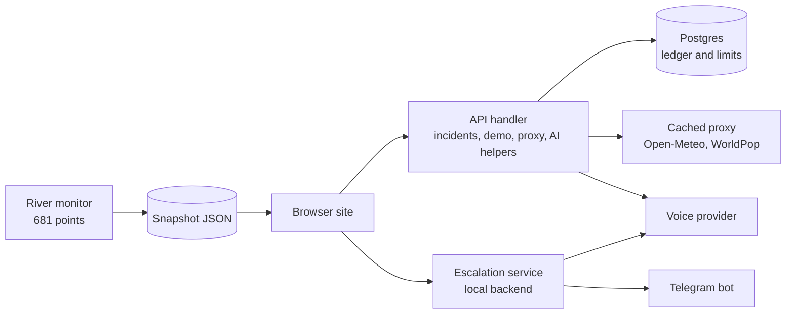

| Part | Where | What it does |
|---|---|---|
| **API handler** | `aws-api/src/handler.ts` | Incidents, contacts, alerts, health. Operator key for writes |
| **Exercise workflow** | `aws-api/src/demo.ts` | Five exercise alerts, approval with a server-side call ledger, cooldown and caps |
| **Telephony** | `aws-api/src/telephony.ts` | Voice call dispatch (OmniDimension, or Twilio). Per-call agent override |
| **Forecast and population proxy** | `aws-api/src/proxy.ts` | Cached pass-through to Open-Meteo and WorldPop, so browsers never hit their limits. Serves the last good answer when rate limited |
| **River monitor** | `local-backend/monitor.mjs`, `aws-api/src/monitor.ts` | Checks 681 points, writes a snapshot, backs off when the daily quota is reached |
| **Escalation** | `local-backend/escalation.mjs` | Sarpanch decision, Telegram sync, citizen call, busy-line retry |
| **Local server** | `local-backend/server.mjs` | Runs the real handler locally, serves the snapshot, routes `/escalation/*` |

**Endpoints**

| Method and path | Purpose |
|---|---|
| `GET /health` | Liveness |
| `GET /incidents`, `POST /incidents`, `PATCH /incidents/{id}` | Incident list, create, lifecycle (operator key) |
| `POST /demo/sessions/{id}/alerts/{id}/approve` | Approve an exercise alert: reserves one call, dials the Sarpanch |
| `GET /proxy/flood`, `GET /proxy/forecast` | Cached GloFAS discharge and rain |
| `GET /proxy/population`, `GET /proxy/population/task` | WorldPop people count in a polygon (create task, poll) |
| `GET /escalation/by-alert/{session}/{alert}` | Live escalation state for the site |
| `POST /escalation/call-result` | Optional provider webhook (token protected) |
| `GET /monitor/status`, `GET /india/snapshot.json` | River monitor state and the snapshot |

```ts
// aws-api/src/telephony.ts: stage 1 uses the two-way agent, stage 2 the citizen agent
agent_id: Number(options.agentId ?? config.omnidimAgent),
call_context: { alert_message: message, place, safe_place },
```

## Two-stage escalation: Sarpanch, then citizens

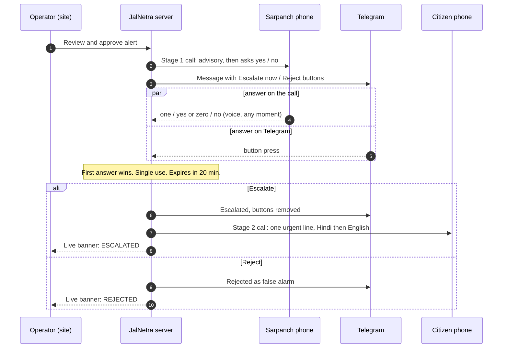

| Say (any moment of the call) | Meaning | The agent replies, then hangs up |
|---|---|---|
| **one / ek / yes / haan** | Escalate | "आपकी सूचना आगे जारी की गई है / Your alert has been escalated." |
| **zero / shunya / no / nahi** | False alarm | "इसे झूठा अलार्म दर्ज किया गया है / Recorded as a false alarm." |
| **two / do** | Heard the full message, no decision | "आपका उत्तर दर्ज किया गया है / Your reply has been noted." |
| **repeat / dobara** | Read the advisory again | |

- **Telegram stays in step.** Every decision, from the call or from Telegram, removes the buttons and posts the outcome.
- **The site shows it live.** A status banner (waiting, escalated, rejected, expired), four steps with ticks and a timestamped log, refreshed every 1.5 s.
- **Citizen message.** One line, male Indian voice, then the call ends: *"बाढ़ का खतरा! आपके क्षेत्र में बाढ़ आ रही है और लगभग 5 घंटे में पहुँचेगी। कृपया तुरंत K.R. High School पर पहुँचें।"* then the same in English.
- **One call at a time.** The provider allows 1 concurrent call on this account, so the citizen call retries every 10 s until the Sarpanch call has ended.

More: [`docs/ESCALATION.md`](jalnetra/docs/ESCALATION.md). Method and every parameter: [`docs/FLOOD-SPREAD-REPORT.md`](jalnetra/docs/FLOOD-SPREAD-REPORT.md).

## Parameters used

| Group | Parameter | Value |
|---|---|---|
| **Inputs** | River discharge | GloFAS v4 via Open-Meteo, 7 Gandak stations (Devghat to Hajipur) |
| | Rain | Open-Meteo / ERA5, 4 points in the Nepal catchment |
| | Terrain | Copernicus DEM as height above nearest drainage (HAND), about 200 m grid |
| | Normal river | JRC permanent surface water (occurrence ≥ 50) |
| **Sentinel-1** | Water threshold | VV below −18 dB, drop of more than 3 dB vs baseline |
| | Baseline | 12 days before each flood date, same relative orbit |
| **River forecast** | Trend damping τ | 10 h |
| | Rain response | 15 m³/s per mm, peak 36 h after the rain |
| | Wave speed | 6.78 km/h between stations |
| | Routing weight | 0.65 of the lagged upstream change |
| | GloFAS blend | w = exp(−h/18) |
| **Flood cell** | Probability | logistic(−7.61 + 12.02·ln(Q/4000) − 0.23·HAND − 0.31·dist) |
| | Wet if | p ≥ 0.15 |
| | Flow used | highest in the previous 72 h |
| **Polygons** | River reach | ±8 km of the village along the river |
| | Water reaches the town | connected water within 1 km of the village |
| | Holes / islands | holes under 60 cells filled, islands under 8 dropped |
| | Evacuation margin | flood now + next step, widened by 3 cells (about 0.6 km) |
| **People and phones** | Population | WorldPop 2020, 100 m, stats API |
| | Fallback | 900 people/km² while WorldPop is slow |
| | Phones per person | 0.6 (assumption) |
| **Escalation** | Decision window | 20 min, first answer wins |
| | Citizen call | 30 s cooldown, retried every 10 s if the line is busy |

## Run it yourself

```bash
cd jalnetra
npm install
(cd aws-api && npm install && npx tsc)         # build the API once
(cd local-backend && npm install)
node local-backend/server.mjs                  # backend on http://127.0.0.1:8787
npm run dev                                    # site on https://localhost:5173/live
```
On Windows, `start-live.cmd` does the same in two windows.

**Rebuild the satellite layers** (Python 3.10+, needs network):
```bash
pip install numpy rasterio scipy pillow planetary-computer pystac-client shapely pyproj
cd pipeline
python dem.py && python lc.py && python corridor.py   # terrain, normal water, height above channel
python s1.py                                          # Sentinel-1 flood masks (o1, o2, o3)
python s2b.py && python s2c.py                        # Sentinel-2 basemap and gap fill
python event.py cfg.json && python build.py           # per-village evidence and the site data (cfg: see the script header)
```

**`.env` (names only, never commit it):**

| Variable | What for |
|---|---|
| `OMNIDIM_API_KEY`, `OMNIDIM_AGENT_ID`, `OMNIDIM_FROM_NUMBER_ID` | Voice provider key, default agent, calling number |
| `OMNIDIM_SARPANCH_AGENT_ID` | Two-way agent for stage 1 (reads the advisory, listens for one / zero / two) |
| `OMNIDIM_CITIZEN_AGENT_ID` | Male-voice agent for stage 2 (one urgent line, then hangs up) |
| `ALERT_PHONE_NUMBER1` | Sarpanch phone (stage 1) |
| `ALERT_PHONE_NUMBER2` | Citizen phone (stage 2) |
| `TELEGRAM_BOT_TOKEN`, `TELEGRAM_CHAT_ID` | Telegram decision buttons and status messages |
| `MONITOR_INTERVAL_MIN` | River monitor interval (default 180) |
| `ESCALATION_TTL_MIN`, `ESCALATION_CALL_RETRY_MIN` | Decision window (20) and busy-line retry window (10) |

**Tests**
```bash
cd jalnetra/aws-api && npm test                          # API: 31 tests
node --test jalnetra/local-backend/escalation.test.mjs   # escalation: 11 tests
npx tsc -p tsconfig.app.json --noEmit                    # site type-check
```

## Repo map

| Path | What |
|---|---|
| `src/` | React 19 + TypeScript + Vite site: Home, Glacier story, Live map, Validation, Route and AR |
| `src/engine/` | River forecast, flood probability, terrain, routing |
| `src/floodSpread/` | Town spread, flood and evacuation polygons ([`zone.ts`](jalnetra/src/floodSpread/zone.ts)), population ([`population.ts`](jalnetra/src/floodSpread/population.ts)) |
| `src/live/sentinel.ts` | Live Sentinel-1 and Sentinel-2 tiles |
| `aws-api/` | Lambda API, river monitor, cached proxy, exercise workflow, with tests |
| `local-backend/` | Local server, river monitor, **two-stage escalation** ([`escalation.mjs`](jalnetra/local-backend/escalation.mjs)) |
| `pipeline/` | Python scripts that build the flood data from Sentinel-1, Sentinel-2, DEM and GloFAS |
| `infra/` | AWS CDK stack and [`AWS-SERVICES.md`](jalnetra/infra/AWS-SERVICES.md) |
| `docs/` | Method report, escalation notes, screenshots |
| `presentation/` | Standalone 3D data-flow scene and the voice-over |

AWS services used (Lambda, EventBridge, API Gateway, S3, CloudFront, WAF, RDS, Secrets Manager, Bedrock, Polly, Location Service, Rekognition, Step Functions, SNS, SQS, CloudWatch): full list and teardown in [`infra/AWS-SERVICES.md`](jalnetra/infra/AWS-SERVICES.md).

## Honest numbers, safety and limits

**How good is it?** Tested against real Sentinel-1 radar flood maps from the 2026 event, leaving each radar date out when training:
- Caught **56% and 66%** of the villages the radar later saw flooded, with false alarms
- Ranking skill (AUC) **0.72 to 0.75** (0.5 is a coin flip)
- An early-warning screen, not a guarantee. **A person always decides**

**Safety by design**
- No call is ever automatic. Opening or selecting an alert never calls anyone
- Phone numbers come from the server environment only. No route accepts a phone number
- Citizens are called **only after the Sarpanch confirms**. A decision is single use and expires
- One attempt per alert, a cooldown, 3 calls per session and a daily cap, enforced on the server
- "Dispatched" is never shown as "answered"

**Limits**
- Fitted to one event (September 2026) with three radar flood maps. Not validated across seasons
- Predicts **whether** water reaches a place, not **how deep**. Embankments and canals are not modelled
- Cells are about 200 m: village scale, not street scale
- Phone counts are estimates (population × an assumed rate). Real device locations are private; in production the zone would go out as one cell broadcast
- The voice provider's API has no keypad input, so answers on the call are spoken. It also cannot hang up a live call from outside, so a Telegram decision does not cut the Sarpanch call
- The free weather API has a daily quota. When it is used up, the page shows the bundled September 2026 replay and says so

## Part 2: Oasis Builder, the prevention app

JalNetra warns when water is coming. **Oasis Builder** helps a community make less of it arrive.

A Unity Android AR app, built on the same flood data:
1. Point the phone at a plot of land. It reads your location and the local weather (humidity, rainfall)
2. Place a tree or a green patch in AR
3. See what that change does: how much rain water the spot can hold, and how much flood runoff it takes off the river

*Status: prototype.* Backend design: Unity app → API Gateway (HTTP API) → Lambda → DynamoDB (session summaries), with S3 for report files, Cognito for sign-in and CloudWatch for logs. Built and run locally with AWS SAM CLI, deployed with `sam deploy`.

## Data

Sentinel-1 and Sentinel-2 (Microsoft Planetary Computer) · GloFAS river discharge and rain (Open-Meteo) · Copernicus DEM GLO-30 · JRC Global Surface Water · ESA WorldCover · WorldPop population · OpenStreetMap · GeoNames

## Team Members

| Name | GitHub ID | AWS Builder Center Alias |
|---|---|---|
| Piyush Agarwal | [GitHub (Piyush5525)](https://github.com/Piyush5525) | @piyush5525 |
| Swastik Dutt | [GitHub (Swastikkkkk)](https://github.com/Swastikkkkk) | @devswastik |
| Veer Jain | [GitHub (vjn6805)](https://github.com/vjn6805) | @vjn6805 |

---

*JalNetra: जल (water) + नेत्र (eye). The eye on the water.*
