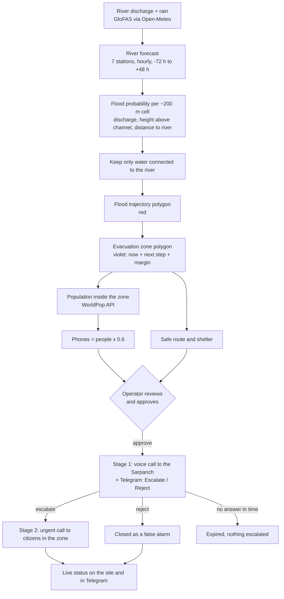
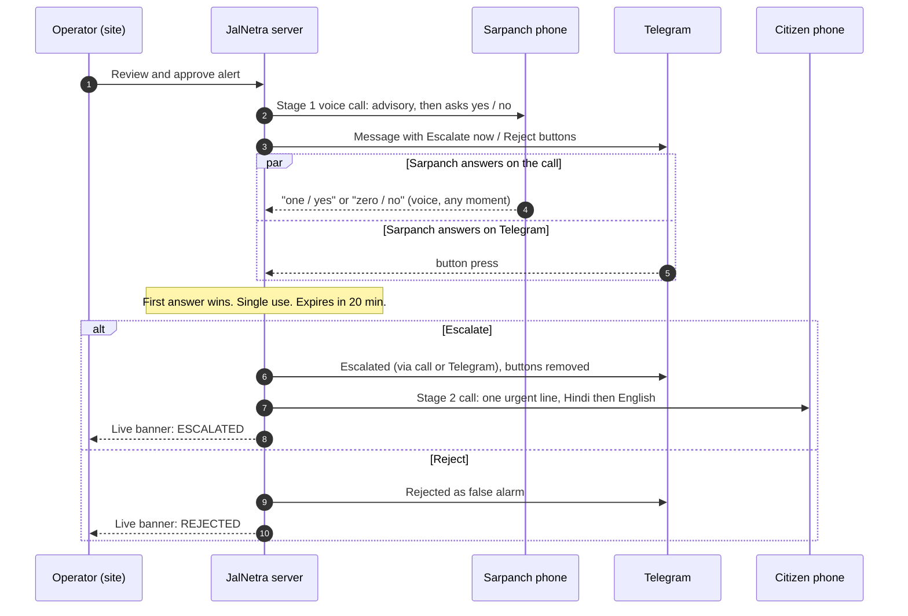
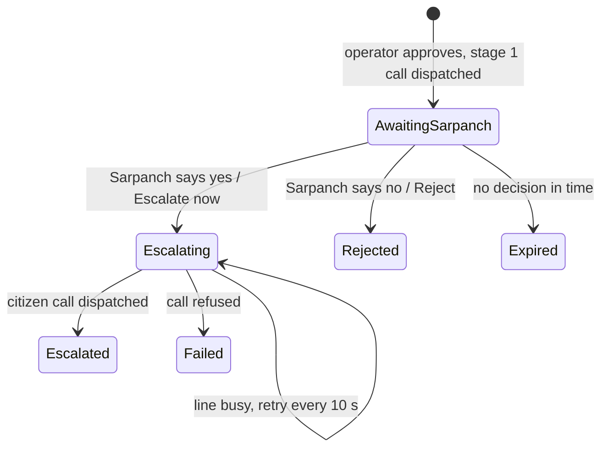
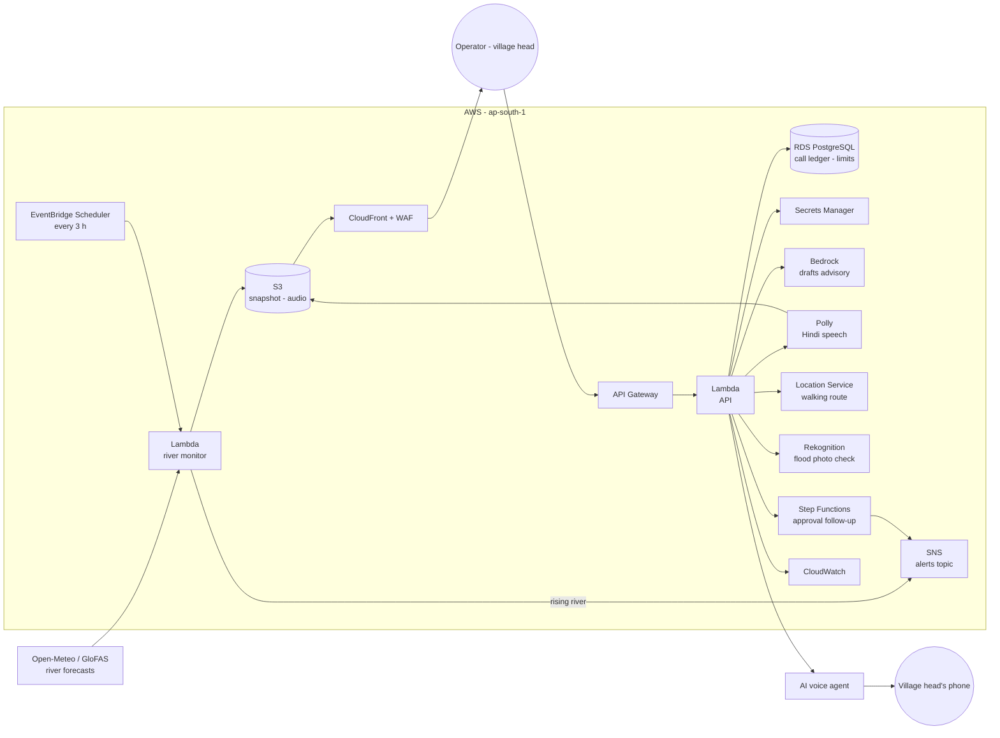
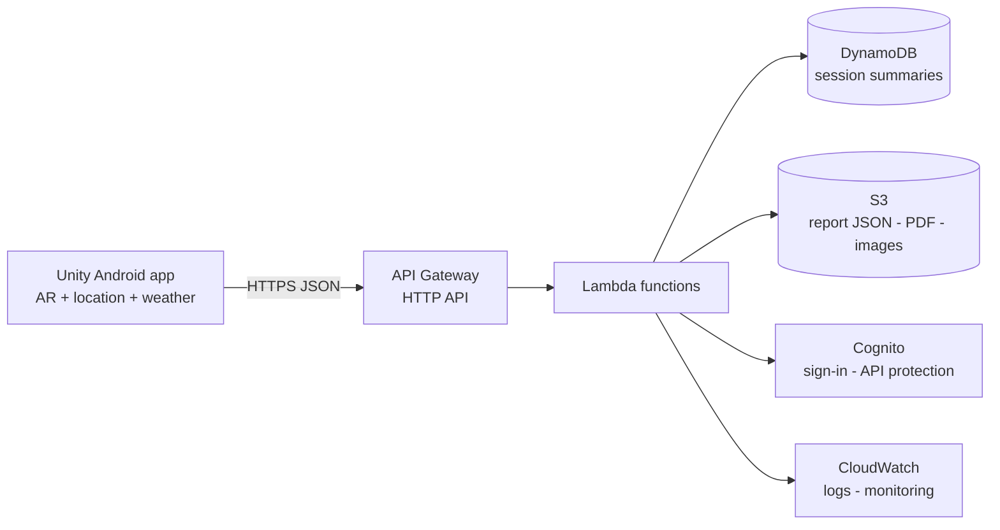

<p align="center"></p>

# JalNetra: Because 2 Hours 43 Minutes Is Too Late

> On 26 August 2026 a glacier collapsed above Langtang in Nepal. The flood raced **226 km** to the Indian border.
> The first alarm on the gauge network came **2 h 43 min** after the collapse. By then the gauges near the source had gone dark, still reading normal.
>
> **JalNetra closes that gap**: it watches every river, finds the villages the water will reach, draws the area that must be emptied, and lets a person approve a Hindi warning that is confirmed by the village head and then escalated to the people in that area. Hours earlier.

**Live demo:** https://d1oi8xa605dsj6.cloudfront.net

<p align="center"></p>
<p align="center"><sub>Harpur at +6 h: the red polygon is where the flood goes, the violet polygon is the evacuation zone, phone icons are the estimated phones inside it.</sub></p>

---

## Contents
1. [What it does](#what-it-does)
2. [The whole flow](#the-whole-flow)
3. [Screenshots](#screenshots)
4. [How a flood becomes a polygon](#how-a-flood-becomes-a-polygon)
5. [Two-stage escalation: Sarpanch, then citizens](#two-stage-escalation-sarpanch-then-citizens)
6. [Parameters used](#parameters-used)
7. [How good is it? (honest numbers)](#how-good-is-it-honest-numbers)
8. [Safety by design](#safety-by-design)
9. [How it runs on AWS](#how-it-runs-on-aws)
10. [Run it yourself](#run-it-yourself)
11. [Repo map](#repo-map)
12. [Limits](#limits)
13. [Part 2: Oasis Builder](#part-2-oasis-builder-the-prevention-app)
14. [Data and team](#data)

---

## What it does

| | |
|---|---|
| **Watch** | 681 river points across India, checked against each river's own record |
| **Predict** | Which of 291 villages along the Gandak the water reaches, and when (now, +3, +6, +12, +24 h) |
| **Map** | A **flood trajectory polygon** (where the water goes) and an **evacuation zone polygon** (what to keep empty), shaped by the flood, not by a circle |
| **Count** | Estimated people and mobile phones inside the evacuation zone (WorldPop population × phones per person) |
| **Decide** | A person reviews the map and the advisory, then approves or rejects. Nothing is automatic |
| **Confirm** | The Sarpanch (village head) gets a two-way voice call and a Telegram message and says *escalate* or *false alarm* |
| **Warn** | Only after the Sarpanch confirms: a short, urgent Hindi + English call goes to the citizens in the zone, plus a 3D evacuation route and an AR arrow to the safe place |

## The whole flow



The flow of the site: **Home → Glacier story → Live map → Approve → the phone rings → the Sarpanch decides → the citizens are called.**

## Screenshots

| | |
|---|---|
| <br/>**Home** | <br/>**Live India map**: every river point, rising ones flagged |
| <br/>**Flood and evacuation route** | <br/>**AWS data flow (3D)** |
| <br/>**Flood trajectory (red), evacuation zone (violet), phones** | <br/>**Live escalation: ESCALATED**, with the live log |

<p align="center"></p>
<p align="center"><sub>The same panel when the Sarpanch rejects: "REJECTED: FALSE ALARM". Nobody else is contacted.</sub></p>

## How a flood becomes a polygon

```mermaid
flowchart LR
  Q[Discharge forecast<br/>per station] --> P[Per-cell flood probability<br/>logistic model]
  P --> T{p at least 0.15?}
  T -- yes --> W[Wet cell]
  W --> CN[4-neighbour flood fill<br/>from river cells]
  CN --> X[Subtract the normal channel<br/>JRC permanent water]
  X --> R[Limit to the river reach<br/>+-8 km of the village]
  R --> H1[Fill small holes<br/>drop tiny islands]
  H1 --> TR[Trace the boundary<br/>simplify and smooth]
  TR --> FP[Flood trajectory polygon]
  FP --> EZ[Add next forecast step<br/>+0.6 km margin]
  EZ --> EP[Evacuation zone polygon]
```



- **Shape comes from the flood.** Cells flood only if their probability passes p* **and** they connect to the river through other flooded cells. There is no radius rule.
- **Two polygons, two jobs.** *Flood trajectory* is the water at the selected time. *Evacuation zone* is that water and the water at the next forecast step, widened by a margin, so people are out before it arrives.
- **People and phones.** The zone polygon is sent to the WorldPop statistics API (100 m population grid). Phones = population × 0.6 (assumption). Icons are placed near mapped villages and each stands for several phones. Positions are illustrative, the count is the estimate.
- **Replay or live.** The page can run on the real September 2026 Gandak flood (replay) or on the live forecast when the live river feed is available.

## Two-stage escalation: Sarpanch, then citizens





| Say (any moment of the call) | Meaning | The agent replies, then hangs up |
|---|---|---|
| **one / ek / yes / haan** | Escalate | "आपकी सूचना आगे जारी की गई है / Your alert has been escalated." |
| **zero / shunya / no / nahi** | False alarm | "इसे झूठा अलार्म दर्ज किया गया है / Recorded as a false alarm." |
| **two / do** | Heard the full message, no decision | "आपका उत्तर दर्ज किया गया है / Your reply has been noted." |
| **repeat / dobara** | Read the advisory again | |

- **Telegram stays in step.** Every decision, from the call or from Telegram, removes the buttons and posts the outcome.
- **The site shows it live.** A status banner (waiting, escalated, rejected, expired), the four steps with ticks, and a timestamped log, refreshed every 1.5 s.
- **Citizen message.** One line, spoken by a male Indian voice, then the call ends: *"बाढ़ का खतरा! आपके क्षेत्र में बाढ़ आ रही है और लगभग 5 घंटे में पहुँचेगी। कृपया तुरंत K.R. High School पर पहुँचें।"* followed by the same in English.
- **One call at a time.** The voice provider allows 1 concurrent call on this account, so the citizen call retries every 10 s until the Sarpanch call has ended.

More detail: [`docs/ESCALATION.md`](jalnetra/docs/ESCALATION.md). Method and every parameter: [`docs/FLOOD-SPREAD-REPORT.md`](jalnetra/docs/FLOOD-SPREAD-REPORT.md).

## Parameters used

| Group | Parameter | Value |
|---|---|---|
| **Inputs** | River discharge | GloFAS v4 via Open-Meteo, 7 Gandak stations (Devghat to Hajipur) |
| | Rain | Open-Meteo / ERA5, 4 points in the Nepal catchment |
| | Terrain | Copernicus DEM as height above nearest drainage (HAND), about 200 m grid |
| | Normal river | JRC permanent surface water |
| **River forecast** | Trend damping τ | 10 h |
| | Rain response | 15 m³/s per mm, peak 36 h after the rain |
| | Wave speed | 6.78 km/h between stations |
| | Routing weight | 0.65 of the lagged upstream change |
| | GloFAS blend | w = exp(−h/18) |
| **Flood cell** | Probability | logistic(−7.61 + 12.02·ln(Q/4000) − 0.23·HAND − 0.31·dist) |
| | Wet if | p ≥ 0.15 |
| | Flow used | highest in the previous 72 h |
| **Polygons** | River reach | ±8 km of the village along the river |
| | Water reaches the town | connected water within 1 km of the village |
| | Holes / islands | holes under 60 cells filled, islands under 8 dropped |
| | Evacuation margin | flood now + next step, widened by 3 cells (about 0.6 km) |
| **People and phones** | Population | WorldPop 2020, 100 m, stats API |
| | Fallback | 900 people/km² while WorldPop is slow |
| | Phones per person | 0.6 (assumption) |
| **Escalation** | Decision window | 20 min, first answer wins |
| | Citizen call cooldown | 30 s, retried every 10 s if the line is busy |

## How good is it? (honest numbers)

Tested against real Sentinel-1 radar flood maps from the 2026 event, leaving each radar date out when training:

- Caught **56% and 66%** of the villages the radar later saw flooded, with false alarms
- Ranking skill (AUC) **0.72 to 0.75** (0.5 is a coin flip)
- An early-warning screen, not a guarantee. **A person always decides**

## Safety by design

- No call is ever automatic. Opening or selecting an alert never calls anyone
- Phone numbers come from the server environment only. No route accepts a phone number
- Citizens are called **only after the Sarpanch confirms**. A decision is single use and expires
- One attempt per alert, a cooldown, 3 calls per session and a daily cap, enforced on the server
- "Dispatched" is never shown as "answered". Failed or unknown outcomes stay locked
- Demo data is labelled on the website and kept apart from real incidents

## How it runs on AWS



| Service | Job |
|---|---|
| **Lambda** | River monitor, API, approvals, helpers |
| **EventBridge Scheduler** | Runs the monitor on a schedule |
| **API Gateway** | Public API, throttled |
| **S3 + CloudFront + WAF** | Website, river snapshot, Hindi audio; rate limits and managed rules |
| **RDS PostgreSQL** | Call ledger, per-alert and daily limits |
| **Secrets Manager** | Keys and the one allowed destination number |
| **Bedrock** (Nova Lite) | Fact-bound Hindi and English advisory drafts, always human-reviewed |
| **Polly** (Kajal) | Spoken Hindi advisory, cached in S3 |
| **Location Service** | Real walking routes to the safe place |
| **Rekognition** | First-screen check of a citizen's flood photo |
| **Step Functions + SNS** | After approval: wait, check, escalate. A call is never retried |
| **SQS** | Alert queue with a dead-letter queue |
| **CloudWatch** | Logs, alarms, the `JalNetra-operations` dashboard |
| **IAM, VPC, CDK** | Least-privilege roles, private networking, infrastructure as code |

Full list, resource names and teardown: [`infra/AWS-SERVICES.md`](jalnetra/infra/AWS-SERVICES.md).

> **Local mode.** `local-backend/` runs the same API handler on your machine (embedded Postgres, `.env` credentials, no AWS), plus the Sarpanch to citizen escalation and the Telegram link. The escalation service is part of the local backend.

## Run it yourself

```bash
cd jalnetra
npm install
(cd aws-api && npm install && npx tsc)         # build the API once
(cd local-backend && npm install)
node local-backend/server.mjs                  # backend on http://127.0.0.1:8787
npm run dev                                    # site on https://localhost:5173/live
```

On Windows, `start-live.cmd` does the same in two windows.

**`.env` (names only, never commit it):**

| Variable | What for |
|---|---|
| `OMNIDIM_API_KEY`, `OMNIDIM_AGENT_ID`, `OMNIDIM_FROM_NUMBER_ID` | Voice provider key, default agent, calling number |
| `OMNIDIM_SARPANCH_AGENT_ID` | Two-way agent for stage 1 (reads the advisory, listens for one / zero / two) |
| `OMNIDIM_CITIZEN_AGENT_ID` | Male-voice agent for stage 2 (one urgent line, then hangs up) |
| `ALERT_PHONE_NUMBER1` | Sarpanch phone (stage 1) |
| `ALERT_PHONE_NUMBER2` | Citizen phone (stage 2) |
| `TELEGRAM_BOT_TOKEN`, `TELEGRAM_CHAT_ID` | Telegram decision buttons and status messages |
| `MONITOR_INTERVAL_MIN` | River monitor interval (default 180) |
| `ESCALATION_TTL_MIN`, `ESCALATION_CALL_RETRY_MIN` | Decision window (20) and busy-line retry window (10) |

**Tests**

```bash
cd jalnetra/aws-api && npm test                          # API: 31 tests
node --test jalnetra/local-backend/escalation.test.mjs   # escalation: 11 tests
npx tsc -p tsconfig.app.json --noEmit                    # site type-check
```

## Repo map

| Path | What |
|---|---|
| `src/` | React 19 + TypeScript + Vite site: Home, Glacier story, Live map, Validation, Route and AR |
| `src/floodSpread/` | Town spread, flood and evacuation polygons ([`zone.ts`](jalnetra/src/floodSpread/zone.ts)), population ([`population.ts`](jalnetra/src/floodSpread/population.ts)) |
| `src/engine/` | River forecast, flood probability, terrain, routing |
| `aws-api/` | Lambda API, river monitor, cached forecast and population proxy, with tests |
| `local-backend/` | Local server, river monitor, **two-stage escalation** ([`escalation.mjs`](jalnetra/local-backend/escalation.mjs)) |
| `infra/` | AWS CDK stack and [`AWS-SERVICES.md`](jalnetra/infra/AWS-SERVICES.md) |
| `pipeline/` | Python scripts that build the flood data from Sentinel and GloFAS |
| `docs/` | Method report and escalation notes, screenshots |
| `presentation/` | Standalone 3D data-flow scene and the voice-over |

## Limits

- The model is fitted to one event (September 2026) with three radar flood maps. It is not validated across seasons.
- It predicts **whether** water reaches a place, not **how deep**. Embankments and canals are not modelled.
- Cells are about 200 m: village scale, not street scale.
- Phone counts are estimates (population × an assumed rate). Real device locations are private. In production the zone would be sent as one cell broadcast.
- Keypad digits are not supported by the voice provider's API. Answers on the call are spoken (*one, zero, two, yes, no*). Real keypad input would need a different phone provider.
- The voice provider cannot hang up a live call from outside, so a Telegram decision does not cut the Sarpanch call. It ends by itself.
- The free weather API has a daily quota. When it is used up, the page shows the bundled September 2026 replay and says so.

## Part 2: Oasis Builder, the prevention app

JalNetra warns when water is coming. **Oasis Builder** helps a community make less of it arrive.

A Unity Android AR app, built on the same flood data:

1. Point the phone at a plot of land. It reads your location and the local weather (humidity, rainfall)
2. Place a tree or a green patch in AR
3. See what that change does: how much rain water the spot can hold, and how much flood runoff it takes off the river

*Status: prototype. The backend below is the serverless design it is built around.*



| Service | Why it is here | When |
|---|---|---|
| **AWS SAM CLI** | Define, run locally and deploy the backend as code | Use |
| **Lambda** | Small functions that save and read reports | Use |
| **API Gateway** (HTTP API) | HTTPS endpoints the app calls | Use |
| **DynamoDB** | Lightweight session and report data | Use |
| **CloudWatch** | Lambda logs and errors | Automatic with Lambda |
| **S3** | Larger exported files and images | Optional for v1 |
| **Cognito** | User accounts and a protected API | After the anonymous prototype works |
| **EventBridge** | Scheduled cleanup or report processing | Optional |

## Data

Sentinel-1 and Sentinel-2 (Microsoft Planetary Computer) · GloFAS river discharge and rain (Open-Meteo) · Copernicus DEM GLO-30 · JRC Global Surface Water · WorldPop population · OpenStreetMap · GeoNames

## Team Members

| Name | GitHub ID | AWS Builder Center Alias |
|---|---|---|
| Piyush Agarwal | [GitHub (Piyush5525)](https://github.com/Piyush5525) | @piyush5525 |
| Swastik Dutt | [GitHub (Swastikkkkk)](https://github.com/Swastikkkkk) | @devswastik |
| Veer Jain | [GitHub (vjn6805)](https://github.com/vjn6805) | @vjn6805 |

---

*JalNetra: जल (water) + नेत्र (eye). The eye on the water.*
